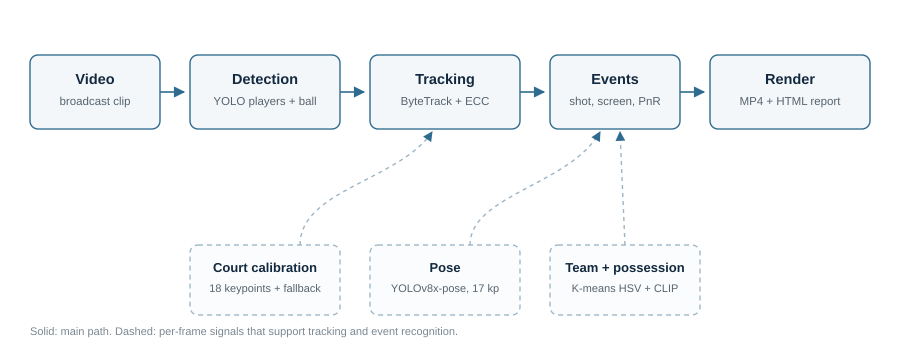

# AI Basketball Coach — Broadcast Perception Pipeline

**Evaluation-first computer vision for broadcast basketball.** Detect and track players
and the ball, estimate pose, calibrate the court, infer teams and possession, recognize
shot events, and render an annotated clip, tactical view, shot chart, and static HTML
report — from one command.

<p>
  
  
  
  
</p>

> **Status:** a research pipeline with committed scorecards, not a production system.
> Broadcast footage and task-specific weights are **not** included. See
> [Data policy](docs/DATA_POLICY.md) before running it.



## What it does

Given a broadcast clip, the pipeline runs:

1. **Detection** — YOLO models for players, the ball, and court keypoints.
2. **Tracking** — ByteTrack/BoT-SORT with ECC camera-motion compensation.
3. **Pose** — YOLOv8x-pose, 17 COCO keypoints per player.
4. **Calibration** — an 18-keypoint court model, with a manual homography fallback.
5. **Team and possession** — zero-shot K-means HSV jersey clustering, with an optional
   CLIP classifier; ball-carrier and team possession with hysteresis.
6. **Event recognition** — online and offline shot, screen, pick-and-roll, and dunk
   detectors with pose-aware gates.
7. **Render and report** — annotated MP4, bird's-eye tactical view, shot chart, event
   timeline, event clips, and a static HTML page a coach can open.

```bash
python scripts/broadcast_demo.py --video /path/to/broadcast.mp4 --event-clips
```

Outputs land in `outputs/broadcast_demo/`:

```
index.html        demo page (video, summary cards, shot chart, event timeline)
clip.mp4          annotated render with overlays and tactical view
clip.json         versioned ClipResult JSON
shot_chart.svg    shot locations on the court
report.md         one-page summary with known failures
stats.csv         per-player/team stats when available
clips/            2–5 second MP4s around each detected event
```

## Results

These are measured on the project's own benchmarks, not vendor claims.

| Stage | Metric | Result |
|---|---|---|
| Ball detection | mAP@50, YOLOv8n, 7,860 images / 17 classes | **96.94%** |
| Court calibration | Median reprojection error, 18-keypoint model | **4.04 ft** (57% better than the 9.5 ft baseline) |
| Tracking | Players tracked per frame, ByteTrack + ECC | **18.9–19.6** |
| Broadcast demo | Raw ball detection, 1,200-frame clip | **73.4%** (up from 52.6%) |
| Shot candidates | Precision on 5 labeled broadcast candidates (Wilson 95% CI) | **0.80** (0.38–0.96) |
| Shot-event benchmark | 162 positive / 28 negative PBP clips, ±3 s | **P 0.55 / R 0.38 / F1 0.45** |

The event layer is the current bottleneck. The committed scorecards include the null
results and the failure taxonomy rather than hiding them. See
[Evaluation](docs/EVALUATION.md) and [Known failures](docs/KNOWN_FAILURES.md).

## Evaluation philosophy

- **No metric without a scorecard.** Every perception change is scored at fixed
  tolerances with confidence intervals.
- **Separate candidate recall from verifier precision.** A detector that finds every
  shot and a verifier that rejects most of them are different problems.
- **Audit the labels before trusting the number.** Misaligned clips are removed and
  the removal is recorded.
- **Report the noise floor.** Shuffled-label checks and grouped scorecards show what
  the metric looks like without signal.
- **Keep the failures.** `docs/KNOWN_FAILURES.md` lists what does not work and why.

## Quickstart

### 1. Environment

```bash
conda env create -f environment.yml
conda activate basketball-perception
python scripts/check_env.py
```

`scripts/check_env.py` verifies Python, PyTorch/CUDA, OpenCV, Ultralytics, and the
other runtime dependencies. A CPU-only PyTorch build works but is slow; see
[docs/ENVIRONMENT.md](docs/ENVIRONMENT.md).

### 2. Public backbone weights

```bash
python scripts/download_models.py
```

This fetches the public `yolov8n.pt` and `yolov8x-pose.pt` checkpoints. It does **not**
fetch the task-specific ball, player, or court models — those were trained on
research-only footage and are not distributed. Put them at the paths documented in
[`models/README.md`](models/README.md).

### 3. Run the demo

```bash
python scripts/broadcast_demo.py \
    --video /path/to/your/clip.mp4 \
    --frames 1200 \
    --event-clips
```

Open `outputs/broadcast_demo/index.html`. To serve it instead:

```bash
python -m http.server 8000 --directory outputs/broadcast_demo
```

### 4. Evaluate

```bash
python eval/score.py --help
python scripts/score_broadcast_events.py
```

The evaluation harness scores event precision/recall at ±1/2/3 s and ±5/15/30 frames,
with Wilson confidence intervals and grouped scorecards.

## Repository layout

```
inference/        pipeline orchestration, schema, device guard, stubs
tracking/         ByteTrack / BoT-SORT integration, ball Kalman filter
homography/       manual calibration + learned 18-keypoint court model
events/           shot, screen, pick-and-roll, dunk detectors
analytics/        team ID, possession, shot features, four factors, xPTS
visualization/    court rendering, tactical view, overlays, heatmaps
state_layer/      game state, lineups, possession ledger, ESPN ingestion
eval/             scoring harness, metrics, committed scorecards
scripts/          demo, calibration, labeling, evals, training entry points
tests/            unit tests for schema, tracking metrics, calibration, demo page
research/         verified bibliography, knowledge notes, experiment backlog
registry/         provenance records for external data sources
docs/             architecture, evaluation, data policy, known failures
```

## Research layer

`research/` is the project's literature and knowledge layer:

- **100 verified sources** (papers, books, rulebooks, official references, datasets)
  with access status and license recorded.
- **22 knowledge notes** across perception, basketball, measurement, systems, and ML.
  Every claim cites a library key and maps to code.
- **44 paper-derived experiments** with a metric, baseline, and owner.

```bash
python research/query.py stats
python research/query.py gaps
python research/query.py track perception.calibration
```

## Known limitations

- **Shot-event recall is weak.** At ±3 s the full-game benchmark is P 0.55 / R 0.38.
  Free throws, passes, and rim-area action are the main false positives.
- **Two clocks.** Candidate frames precede the play-by-play event by a median 3.2 s;
  release-time calibration is an open problem.
- **Camera-regime transfer fails.** The broadcast detector does not transfer to a
  fixed top-down high-school camera (0/2 labeled candidates). Phase B needs its own
  calibration and verifier.
- **Team ID and shooter attribution can drift,** especially on top-down footage.
- **Not real-time.** The demo caps at 1,200 frames and runs offline.
- **No commercial-clean model.** Training data includes research-only footage; the
  shipped weights are not cleared for redistribution.

## Lineage

This project began in 2024 as a shoot-around shot counter
([basket-event-detection](https://github.com/ianmparker/basket-event-detection)): a
YOLO ball/hoop detector that counted made baskets. That repository is archived. The
current pipeline supersedes it with multi-object tracking, court calibration, a
versioned result schema, and committed evaluation scorecards.

## Data policy

This repository contains **no broadcast video, extracted frames, or trained task
weights**. It ships code, documentation, aggregate scorecards, and labels for
Wikimedia Commons footage. You must supply your own video and comply with its license.
See [docs/DATA_POLICY.md](docs/DATA_POLICY.md).

## License

**AGPL-3.0.** The pipeline depends on Ultralytics YOLO, which is AGPL-3.0. See
[LICENSE](LICENSE) and [NOTICE](NOTICE) for third-party attributions.

## Contributing

Issues and pull requests are welcome. Please read [CONTRIBUTING.md](CONTRIBUTING.md)
first — in particular, do not commit footage, weights, or data derived from
research-only sources.
